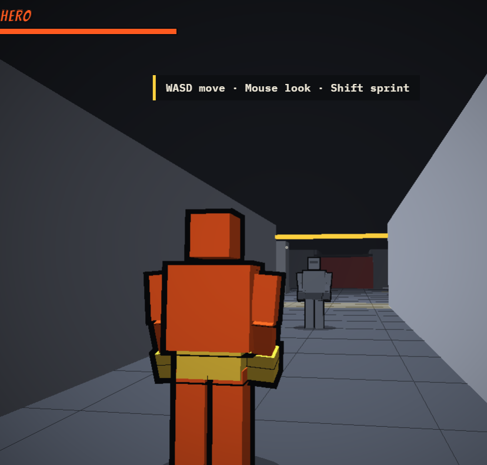

# Greybox Prototyping

**Prompt templates for making game prototypes with AI-written code: one gameplay question, one HTML file, tuned by hand.**

*Heavy Hands, a prototype made with these prompts.*

Each prototype is a browser build with simple shapes instead of art, made to answer one gameplay question. An AI writes the code. I decide what it should do and judge it by playing. The game-feel numbers are sliders, so I tune by hand instead of re-prompting.

## Not a coder, but…

I'm a game designer, not a programmer. I can't write this code myself. I read it to follow roughly what it does and to catch fixes that don't make sense, and I test everything by playing.

These prompts make prototypes that answer design questions. They don't make production code. A real game would need its code rebuilt properly (see [Moving to a real game](#moving-to-a-real-game)).

## The prompts

| Prompt | Use it to |
|---|---|
| [`01-first-build.md`](prompts/01-first-build.md) | Get the first playable build, with a tuning panel built from one table |
| [`02-one-change.md`](prompts/02-one-change.md) | Make one change, report a bug, or undo a bad change |
| [`03-extend.md`](prompts/03-extend.md) | Add new systems to a build that already works |
| [`04-combine-systems.md`](prompts/04-combine-systems.md) | Make two working systems interact |
| [`05-asset-list.md`](prompts/05-asset-list.md) | List every placeholder the game uses, as a replacement checklist |
| [`06-placeholder-drafts.md`](prompts/06-placeholder-drafts.md) | Get crude drafts at the real size to redraw by hand |
| [`07-readme.md`](prompts/07-readme.md) | Write a README that only describes what's in the code |
| [`08-transfer.md`](prompts/08-transfer.md) | Sort the sliders, then get a system spec and a data file for a rebuild |

## The rules

- **One question per prototype.** If you have two, make two prototypes.
- **Greybox the art, not the feedback.** Simple shapes, flat colours, no finished art, no music. Juice stays in (see [below](#greybox-but-juicy)).
- **One HTML file.** It opens in a browser, with no engine, installs or build steps. It's quick to make, share and throw away.
- **Expose the gameplay variables.** Ask the AI to put game-feel values on sliders. They become the record of what to keep, tune and cut (see [below](#keep-tune-cut)).
- **Tune by feel.** Change one number, play, compare. "Heavier" is vague in a prompt and obvious on the controls.
- **Build systems, then combine them.** In Heavy Hands II, grabbable enemies plus enemies that shoot produced a human shield, which wasn't planned on paper.
- **Fix before you add.** Don't build new features on something that doesn't work yet.
- **One change per prompt.** When something breaks, you know what caused it.
- **Learn enough code to judge the output.** You don't have to write it, but you need to notice when a fix is wrong.

## Greybox, but juicy

"Juice" is the feedback layered on top of an action so it feels better: the game answers an input with more than the input itself. A jump that only moves a box upward works, but it feels flat. Add a squash before take-off, a stretch in the air, a puff of dust and a thud on landing, and the same jump feels springy. The rules haven't changed, only the feedback.

Some juice looks like art, but it changes how a game plays or reads, so it belongs in the greybox. It applies to any genre:

| Action | Juice | What it does for gameplay |
|---|---|---|
| **Melee hit** | Hit-stop (a few frozen frames), impact frames, knockback | Confirms the hit and its strength. Knockback changes spacing, so it's also a rule. |
| **Jump and land** | Squash and stretch, landing dust, a small camera dip | Shows the exact moment of landing, so you can time the next jump |
| **Driving fast** | Camera pulls back or widens its field of view, engine pitch rises, speed lines | Makes speed readable without looking at a number |
| **Shooting** | Recoil kick, muzzle flash, a hit marker and sound | Confirms a hit on a target too far away to see clearly |
| **Matching tiles** | Pieces snap into place with a pop, pitch rises on each match in a chain | Confirms a valid move, and shows a chain is building |
| **Balancing or holding** | The object strains, creaks or shakes more as it nears its limit | Warns you before you fail, so failure feels fair |
| **Being spotted** | A meter fills with a rising sound | Shows how close you are to being caught |
| **Picking something up** | The item pops, the counter bumps | Confirms the pickup without reading the HUD |

The test: **if switching it off changes how the game plays or reads, it's juice and stays in. If it only changes the look, it's art and waits.**

In the greybox, juice is crude on purpose, like a white flash or a synthesised thud. What gets tested is its timing and strength, so each effect gets a slider. When the real art arrives, the effects get redrawn and the numbers stay.

Juice can also hide a weak mechanic. Switch it off now and then and check the mechanic holds up on its own.

## Keep, tune, cut

The useful output of a prototype is the set of variables that make the mechanic work and the values that felt right. By the end, sort every slider into a group:

| Group | Meaning | Example |
|---|---|---|
| **Keep** | Found, and it holds up across sessions and players | Hit-stop of 4 frames on a light hit |
| **Tune** | Still moving, or depends on content that doesn't exist yet | Enemy health, which depends on level count. Note the range that worked. |
| **Cut** | Never changed how the game felt | Remove it. Fewer variables means a simpler system. |

Keep values and tune ranges transfer to the real game, together with the variable names. Prompt 01 asks for a **Copy values** button that copies every slider value as JSON. Prompt 08 has the table to sort them in.

## Moving to a real game

A greybox prototype proves the feel. It isn't built to grow into a finished game. These prompts stop at the prototype and don't produce engine code. The steps below are the checklist for going further.

**Art and sound**

1. **List every asset** with prompt 05. It becomes the replacement checklist.
2. **Get crude drafts at the real size** with prompt 06. They show proportions. Then redraw every one by hand.
3. **Redraw the juice, keep its timing.** Effects and sounds get new versions. Their duration and strength stay as tuned.
4. **Re-playtest.** New art changes the feel, and busy art can bury feedback that read clearly in grey.

**Code**

5. **Treat the prototype as a spec, not a codebase.** Rebuild in an engine instead of stretching the HTML file. Prompt 08 asks an AI to write a system spec and a data file from the prototype and your slider table.
6. **Carry the numbers over, not the code.** Put the keep values and tune ranges into the new build as data (a config file or engine resource), so they can still be adjusted without touching code. They are targets, not exact copies: convert frames to seconds, compare side by side with the prototype, and expect real animations to shift some of them.
7. **Get a programmer to review it.** Someone who codes should check the structure, performance and anything that handles player data or money before it ships.
8. **Use version control and test on real hardware.** Make small commits, and check the frame rate on the slowest machine you want to support.

**Disclosure**

9. **Say how it was made.** Steam's AI disclosure (updated January 2026) covers AI-generated content that ships with the game, including store page text and marketing, and content generated while the game runs. AI tools used during development for efficiency, such as coding assistants, are not what it asks about. itch.io's project page has a generative-AI question (required for asset pages since November 2024). If you answer yes, you tag graphics, sound, text and dialogue, or code.

## Further reading

- Martin Jonasson and Petri Purho, [Juice It or Lose It](https://gdcvault.com/play/1016789/Juice-It-or-Lose) (GDC Europe 2012): juice
- Masahiro Sakurai on [hitstop](https://sourcegaming.info/2015/11/11/thoughts-on-hitstop-sakurais-famitsu-column-vol-490-1/) (translated Famitsu column): hit-stop
- Squirrel Eiserloh, [Juicing Your Cameras With Math](https://gdcvault.com/play/1023146/Math-for-Game-Programmers-Juicing) (GDC 2016): screen shake
- Glenn Fiedler, [Fix Your Timestep!](https://gafferongames.com/post/fix_your_timestep/): the fixed 60 Hz loop the first-build prompt asks for

## License and credits

The prompts are under the [MIT License](LICENSE). Heavy Hands, shown in the screenshot, is not.

Created by Kostis Spyroglou, developed with the help of Claude.
